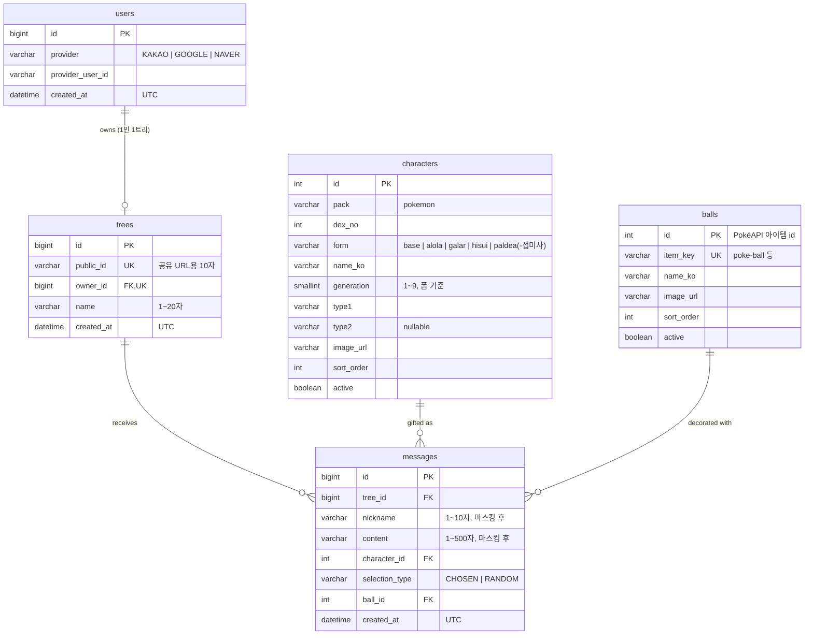

# ERD

> 버전 1.0 · 2026-11-18 · 상태: **확정** (구현 중 바뀌는 내용은 새 버전으로 기록)
> 근거: [기능 정의서](features.md), [정책 정의서](policies.md) · DBMS: **MySQL 8.0.16 이상** (운영은 배포 인프라 제공, 로컬·테스트는 MySQL 8.4 LTS). 2026-11-19 PostgreSQL에서 전환 (#33)

## 다이어그램



## 테이블 상세

### users — 트리 주인 계정

| 컬럼 | 타입 | 제약 | 설명 |
|---|---|---|---|
| id | `bigint` | PK, AUTO_INCREMENT | |
| provider | `varchar(10)` | NOT NULL, CHECK (`KAKAO`,`GOOGLE`,`NAVER`) | POL-ACC-04 |
| provider_user_id | `varchar(255)` | NOT NULL, **utf8mb4_bin** (대소문자 구분) | 제공자 고유 ID. 로그에 남기지 않음 (POL-PRV-05) |
| created_at | `datetime(6)` | NOT NULL, default `CURRENT_TIMESTAMP(6)`, UTC | |

- UNIQUE (`provider`, `provider_user_id`)
- 이메일·이름 등은 컬럼 자체가 없다 (POL-PRV-01)

### trees — 크리스마스 트리

| 컬럼 | 타입 | 제약 | 설명 |
|---|---|---|---|
| id | `bigint` | PK, AUTO_INCREMENT | 내부용. URL에 노출하지 않음 |
| public_id | `varchar(10)` | NOT NULL, UNIQUE, **utf8mb4_bin** (대소문자 구분) | 공유 링크 ID (POL-TRE-03, A-03) |
| owner_id | `bigint` | NOT NULL, UNIQUE, FK → users.id ON DELETE CASCADE | UNIQUE로 1인 1트리 보장 (POL-TRE-01) |
| name | `varchar(20)` | NOT NULL | 필터를 통과한 이름만 저장 (POL-FLT-06) |
| created_at | `datetime(6)` | NOT NULL, default `CURRENT_TIMESTAMP(6)`, UTC | |

### messages — 메시지 (장식)

| 컬럼 | 타입 | 제약 | 설명 |
|---|---|---|---|
| id | `bigint` | PK, AUTO_INCREMENT | |
| tree_id | `bigint` | NOT NULL, FK → trees.id ON DELETE CASCADE | 탈퇴 시 함께 삭제 (POL-PRV-03) |
| nickname | `varchar(10)` | NOT NULL | 마스킹 후 (POL-MSG-02) |
| content | `varchar(500)` | NOT NULL | 마스킹 후, 일반 텍스트 (POL-MSG-01, 07) |
| character_id | `integer` | NOT NULL, FK → characters.id | 포켓몬 팩의 행을 가리킨다 (POL-CHR-02) |
| selection_type | `varchar(10)` | NOT NULL, CHECK (`CHOSEN`,`RANDOM`) | 작성자 화면 표시에 쓴다 (POL-CHR-04) |
| ball_id | `integer` | NOT NULL, FK → balls.id | 장식으로 달리는 볼. **작성자가 고른다** (기본값 몬스터볼). 12/25 전에도 트리에 보인다 |
| created_at | `datetime(6)` | NOT NULL, default `CURRENT_TIMESTAMP(6)`, UTC | 장식 배치 순서 (POL-TRE-04) |

- INDEX (`tree_id`, `created_at`) — 트리 화면 조회와 페이지 넘김
- INDEX (`tree_id`, `character_id`) — 랜덤 후보 계산과 모아보기 집계
- 삭제는 행 삭제(hard delete)다 (POL-MSG-06)
- MySQL `utf8mb4`의 `varchar(n)`은 글자 수 기준이라 한글·이모지 길이 제한과 맞는다. 앱에서도 같은 기준으로 검증한다
- MySQL 기본 콜레이션(`utf8mb4_0900_ai_ci`)은 대소문자를 구분하지 않는다. 대소문자가 다른 값을 구분해야 하는 컬럼(공유 ID, 제공자 고유 ID, 볼 아이템 키)은 `utf8mb4_bin`으로 둔다
- 길이 초과는 MySQL `STRICT` 모드에서만 오류가 난다(아니면 잘려서 저장). 운영 DB의 `sql_mode`와 상관없이 앱에서 먼저 검증한다

### characters — 캐릭터 팩 (포켓몬)

| 컬럼 | 타입 | 제약 | 설명 |
|---|---|---|---|
| id | `integer` | PK | **`도감 번호 × 100 + 폼 번호`** (피카츄 2500, 알로라 라이츄 2601). 시드 스크립트가 이 규칙으로 정하므로 다시 시드해도 바뀌지 않는다 (메시지가 참조) |
| pack | `varchar(20)` | NOT NULL | 현재 `pokemon`만 있음 |
| dex_no | `integer` | NOT NULL | 전국도감 번호 |
| form | `varchar(20)` | NOT NULL, default `base` | `base`, `alola`, `galar`, `hisui`, `paldea` (POL-CHR-01). 한 지역에 폼이 여럿이면 접미사로 구분한다: 팔데아 켄타로스 `paldea-combat`, `paldea-blaze`, `paldea-aqua` |
| name_ko | `varchar(50)` | NOT NULL | 화면 이름. **리전폼도 원래 이름 그대로** (알로라 라이츄 → `라이츄`, 팔데아 켄타로스 3종 → `켄타로스`). 구분은 `form`으로만 한다 (POL-CHR-06) |
| image_url | `varchar(500)` | NOT NULL | 외부 스프라이트 URL (A-09) |
| generation | `smallint` | NOT NULL, CHECK 1~9 | 폼이 처음 나온 세대 (POL-CHR-07). 알로라 라이츄 = 7 |
| type1 | `varchar(10)` | NOT NULL | 첫 번째 타입. PokéAPI 영문 이름 (`electric` 등) |
| type2 | `varchar(10)` | NULL | 두 번째 타입. 단일 타입이면 NULL |
| sort_order | `integer` | NOT NULL | 선택기 정렬 (도감 번호 → 폼) |
| active | `boolean` | NOT NULL, default `true` | 선택기에 노출할지 |

- UNIQUE (`pack`, `dex_no`, `form`)
- 데이터는 Flyway가 아니라 **시드 스크립트**로 넣는다. 저장소에 포켓몬 데이터 파일을 커밋하지 않기 위해서다 (POL-IP-04, A-10)

### balls — 장식용 볼

| 컬럼 | 타입 | 제약 | 설명 |
|---|---|---|---|
| id | `integer` | PK | **PokéAPI 아이템 id** 그대로. 다시 시드해도 바뀌지 않는다 (메시지가 참조) |
| item_key | `varchar(30)` | NOT NULL, UNIQUE, **utf8mb4_bin** | PokéAPI 아이템 이름 (`poke-ball`, `lapoke-ball` 등) |
| name_ko | `varchar(30)` | NOT NULL | 화면 이름. 일반 볼과 이름이 겹치는 히스이 볼 4종은 `몬스터볼(히스이)`, `슈퍼볼(히스이)`, `하이퍼볼(히스이)`, `헤비볼(히스이)` |
| image_url | `varchar(500)` | NOT NULL | 외부 아이템 스프라이트 URL (POL-IP-03) |
| sort_order | `integer` | NOT NULL | 볼 선택기 정렬 |
| active | `boolean` | NOT NULL, default `true` | 선택기에 노출할지 |

- PokéAPI `item-pocket/pokeballs`의 38종 전체 (일반, 특수, 구 볼, 히스이). 2026-11-18 기준 모두 한국어 이름과 스프라이트가 있다
- 데이터는 characters와 같은 시드 스크립트로 넣는다

## 저장하지 않는 것

| 데이터 | 처리 | 정책 |
|---|---|---|
| 로그인 세션 | 서버 메모리 (Spring Session 미사용) | POL-ACC-03 |
| Rate Limit 카운터, IP 주소 | 서버 메모리 | POL-ABU-02 |
| 작성 중인 메시지 | 작성자 브라우저 로컬스토리지 | POL-MSG-05 |
| 마스킹 전 원문 | 저장하지 않음 | POL-FLT-03 |
| 대체 캐릭터 팩 | DB가 아니라 FE 에셋 + 매핑 규칙 | 아래 참고 |
| 공지 배너 문구, 공개 시각, 활성 팩, 켜진 로그인 제공자 | 서버 설정(환경 변수) | |

## 대체 팩 매핑

대체 팩은 직접 만든 오너먼트 N종으로, 저장소에 넣는다. DB는 바꾸지 않는다.

```
활성 팩이 pokemon  → characters.name_ko, image_url 을 그대로 쓴다
활성 팩이 ornament → ornament 번호 = characters.dex_no % N
                     이름은 "오너먼트 #번호", 이미지는 FE 에셋
```

- 응답을 만드는 서버의 한 곳(`CharacterPresenter` 등)에서만 이 규칙을 적용한다. FE는 응답에 들어 있는 이름과 이미지 URL만 쓴다
- 대체 팩일 때는 포켓몬 선택기를 끄고, 오너먼트 N종 중에서 고르게 한다 → 이때 선택값은 해당 오너먼트에 대응하는 대표 `characters.id`로 저장한다 (세부 사항은 구현 시 확정)
- **볼도 공식 디자인이므로 함께 바꾼다.** 대체 팩일 때 장식은 일반 크리스마스 볼 M종으로 보여 준다: `장식 번호 = balls.id % M`, 이미지는 FE 에셋. 볼 선택기도 M종 중에서 고르게 하고, 선택값은 대응하는 대표 `balls.id`로 저장한다

## 주요 쿼리

```sql
-- 랜덤 후보 (POL-CHR-03): 이 트리가 받지 않은 활성 캐릭터
SELECT c.id FROM characters c
WHERE c.pack = 'pokemon' AND c.active
  AND NOT EXISTS (SELECT 1 FROM messages m WHERE m.tree_id = :treeId AND m.character_id = c.id)
ORDER BY random() LIMIT 1;
-- 결과가 없으면 조건 없이 전체에서 다시 뽑는다

-- 받은 포켓몬 모아보기 (POL-CHR-05)
SELECT character_id, count(*) AS times, min(created_at) AS first_received
FROM messages WHERE tree_id = :treeId
GROUP BY character_id ORDER BY first_received;
```

- 캐릭터가 약 1,100행이라 `ORDER BY random()`으로도 충분하다고 본다 (추정)
- 동시에 랜덤을 두 번 보내면 같은 포켓몬이 나올 수 있다. 정책상 문제없다고 보고 잠금은 걸지 않는다

## 마이그레이션 계획

| 파일 | 내용 |
|---|---|
| `V1__create_users_trees_characters_messages.sql` | 위 5개 테이블(users, trees, characters, balls, messages), 제약, 인덱스 |
| (시드) `scripts/seed-characters` | PokéAPI → characters, balls. 배포 환경에서 1회 실행, 다시 실행해도 같은 결과(idempotent). 세대는 `pokemon-form` → `version_group` → `generation`, 타입은 `pokemon.types`에서 받는다 (POL-CHR-07) |

## 용량 추정

- 메시지 1행 ≈ 최대 2 KB (내용 500자 × 한글 UTF-8 3바이트 + 나머지 컬럼과 인덱스)
- 트리당 최대 200개(A-08) → 트리 하나에 최대 약 0.4 MB
- 500 MB 기준으로 꽉 찬 트리 약 1,200개 분량이다. 실제로는 대부분 트리가 훨씬 적게 받을 것으로 보지만, **사용자 수는 추정 근거가 없다**
